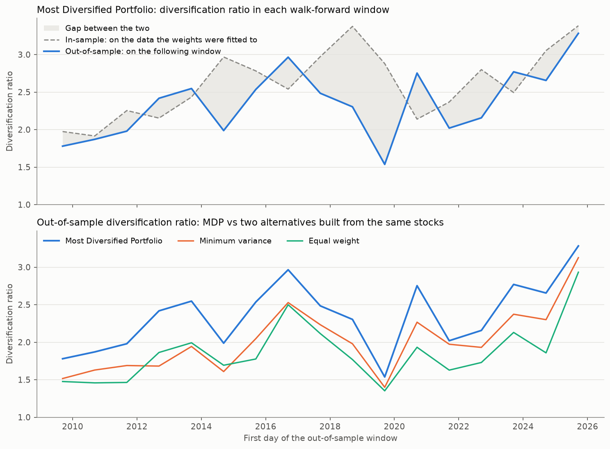
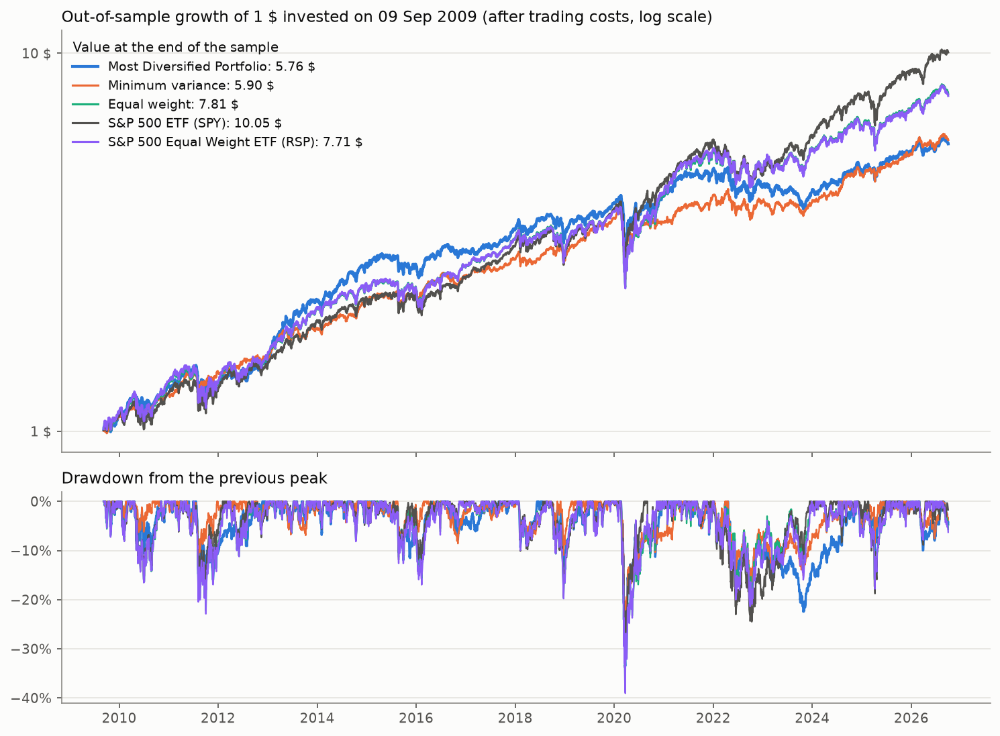
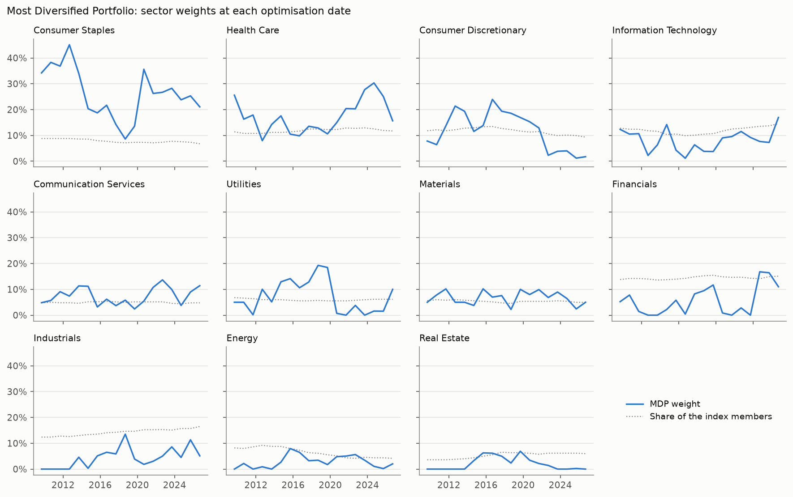
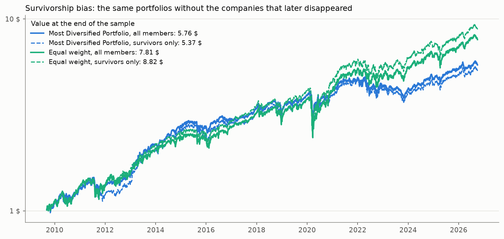
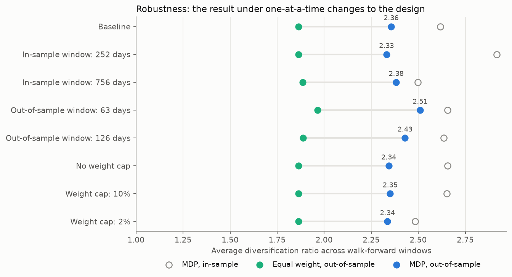
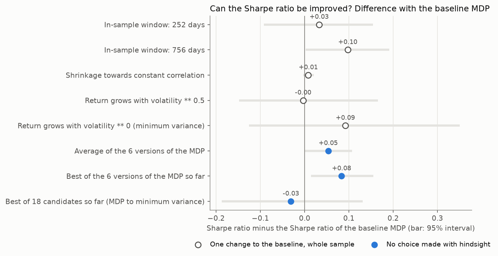

# Does Maximum Diversification Survive Out-of-Sample? A Walk-Forward Analysis on the S&P 500 With Its Delisted Members

**Question.** Choueifaty's *Most Diversified Portfolio* (MDP) is the portfolio with the
highest diversification ratio. The weights are chosen with past data, but the investor
holds the portfolio in the future. Is it still the most diversified portfolio in the
months *after* the optimisation, and is that worth anything, once the companies that
were later taken over or went bankrupt are put back into the sample?

**Short answer (S&P 500 with the members of each date, rebalanced once a year: 17 yearly walk-forward windows, September 2009 – September 2026).**

| | Result |
|---|---|
| Diversification ratio the optimiser reaches **in-sample** | 2.62 |
| Diversification ratio of the same weights **out-of-sample**, held for a year | **2.36**: 90% survives (90% like for like) |
| Against **equal weight** in the same stocks (out-of-sample) | 2.36 vs 1.86. The MDP is higher in **all 17 windows** (t = 11.2) |
| Against **minimum variance** in the same stocks (out-of-sample) | 2.36 vs 2.01. The MDP is higher in **all 17 windows** (t = 8.1) |
| Did more diversification mean **more return**? | **No.** 10.8% per year, like minimum variance (11.0%) and less than equal weight (12.8%) and the S&P 500 fund (14.5%) |
| Did it mean **less risk**? | **Less volatility, yes** (14.7% against 17.0% for the S&P 500 fund and 17.5% for equal weight), with a beta of 0.73. The worst fall was the same (−34%) |
| How large is the **survivorship bias**? | With only the companies that still trade today, equal weight would have shown 13.6% per year instead of 12.8% (**+0.8 points**). For the MDP it goes the other way (10.4% against 10.8%): it had on average **23% of its money** (up to 50%) in companies that have since left the stock market, and they did well |
| Can its **Sharpe ratio be improved** without choosing with hindsight? | **Somewhat.** Letting the strategy pick, with past data only, how it estimates the correlations raises it from 0.68 to 0.76 (S&P 500 fund: 0.80). The 95% interval of the gain is +0.01 to +0.15: positive, by little. Giving it 18 candidates to choose from makes it worse (0.64). See [section 5](#5-can-the-sharpe-ratio-be-improved) |
| How complete is the universe? | Between **95.0% and 99.8%** of the index members have prices on every day (98.3% on average). 100% is not reachable with free data: see [section 1](#1-data-and-what-is-missing) |

The diversification ratio (DR) is the weighted average volatility of the stocks divided
by the volatility of the portfolio. A DR of 2.36 means that the portfolio is 2.36 times
less volatile than its average holding.

Other findings:
- **The equal-weight portfolio built here matches the fund that does the same with real money.** It returns 12.8% per year against 12.7% for the equal-weight S&P 500 fund (RSP), with a correlation of 0.997 between their daily returns. That fund holds every member, including the ones that later disappeared, so this is an independent check of the universe and of the prices.
- **The MDP is a bet against the market portfolio, by construction.** It puts 26% in consumer staples (8% of the index members) and 6% in financials (14% of the members). It did better than the index fund until 2016 and worse afterwards, when a few very large technology companies drove the index.
- **Rebalancing once a year halves the trading, and leaves money idle.** The MDP replaces 56% of the portfolio per year (106% with a quarterly rebalance). But a company that is taken over stays as cash until the next rebalance: on an average day that is 4.3% of the MDP, five times more than in equal weight.
- **Delisted companies are a large part of the past index.** On the first optimisation date (September 2009), 168 of the 500 members were companies that Yahoo Finance no longer has: 143 have prices here and 25 do not.
- **The result does not depend on the design.** In the baseline and in seven alternative designs the MDP has a higher out-of-sample DR than equal weight in 99% to 100% of the windows.

Every number in this README comes from [`results/summary.md`](results/summary.md) or from the
detail files next to it ([`windows.csv`](results/tables/windows.csv), one row per window, and
[`daily_returns.csv`](results/tables/daily_returns.csv)). `python run_all.py` generates all of them.



---

## Contents
1. [Data, and what is missing](#1-data-and-what-is-missing)
2. [Methodology, step by step](#2-methodology-step-by-step)
3. [Results](#3-results)
4. [Robustness](#4-robustness)
5. [Can the Sharpe ratio be improved?](#5-can-the-sharpe-ratio-be-improved)
6. [Limitations](#6-limitations)
7. [How to reproduce](#7-how-to-reproduce)
8. [Repository structure](#8-repository-structure)
9. [References](#9-references)

---

## 1. Data, and what is missing

A backtest that uses today's index members looks only at the winners: the companies that
went bankrupt or were bought on the cheap are not in the list. Avoiding that takes two
things, and the second one is the hard one.

| What | Source | Notes |
|---|---|---|
| Members of the S&P 500 on each date | [fja05680/sp500](https://github.com/fja05680/sp500) (MIT licence), commit of 7 September 2026 | One row per date on which the index changed, with every member of that date. 977 stays in the index since November 2006 |
| Prices of the companies that still trade | Yahoo Finance, adjusted close | 624 companies. Includes dividends and splits |
| Prices of the companies that no longer trade | [bolsamania.com](https://www.bolsamania.com), daily close | 198 companies. Prices as traded, from 30 November 2006: **no dividends**, and splits adjusted by hand |
| Market references | Yahoo Finance: SPY and RSP | S&P 500 funds, weighted by market value and equally. Both include dividends |
| Risk-free rate | FRED: `DTB3` | 3-month Treasury bill |
| Names and sectors | iShares IVV holdings; Yahoo Finance for former members | GICS sectors. Delisted companies: [`data/reference/delisted.csv`](data/reference/delisted.csv) |

### Who was in the index

The membership source has two files. The first one ends in January 2019 and marks the
companies that no longer trade with the month of their delisting (`LEHMQ-201203`), which
keeps apart two companies that used the same ticker (`AGN-201503` is the old Allergan and
`AGN` is Actavis, which took its name). The second file reaches the present with plain
tickers. The first one is used up to its last date and the second one afterwards. Joined,
they give between 498 and 507 members on every date. Two defects of the source are
corrected: ten companies delisted in 2018 appear under two names, and Linde is missing for
ten weeks after it replaced Praxair ([`maxdiv/universe.py`](maxdiv/universe.py)).

### Prices of companies that no longer exist

Yahoo Finance deletes a company when it stops trading. The paid databases that keep them
(CRSP, Norgate, EODHD) are the usual answer. This project uses a free one: bolsamania.com
keeps a page with the daily prices of delisted US shares. A page was looked for each of
the 237 members that Yahoo no longer has and that were still in the index in December 2008
or later, and it was accepted only after checking that:

- it quotes in **dollars** (the same company often has another page for its listing in Germany, in euros, or in Mexico);
- its last prices match what the company was worth when it left;
- it covers the days on which the company was in the index.

A company that changed exchange has two pages, one for each (Juniper: Nasdaq until 2009,
NYSE afterwards). They are joined. The list is in
[`data/reference/delisted.csv`](data/reference/delisted.csv): 198 companies with a page
and 97 without (71 of these left the index before the backtest starts).

### Why the backtest starts in September 2009

The delisted companies have prices from 30 November 2006, so the first optimisation with a
two-year window could be in December 2008. On that date 38 of the 500 members have no
prices (92.4% coverage). Most of them are companies that stopped trading before mid-2009
(Merrill Lynch, Wachovia, National City, Rohm and Haas), which the source does not keep.
The backtest starts on the first date from which **at least 95% of the members have prices
on every trading day**: 4 September 2009.

| Date | Index members | With prices | Without prices | Coverage |
|---|---|---|---|---|
| 2008-12-02 | 500 | 462 | 38 | 92.4% |
| 2009-06-04 | 499 | 473 | 26 | 94.8% |
| **2009-09-04** (first optimisation) | 500 | 475 | 25 | **95.0%** |
| 2011-09-06 | 500 | 481 | 19 | 96.2% |
| 2015-09-09 | 502 | 488 | 14 | 97.2% |
| 2019-09-11 | 505 | 503 | 2 | 99.6% |
| 2026-09-18 | 503 | 502 | 1 | 99.8% |

**34 members have no prices for all or part of their stay** during the backtest. The largest
gaps are Total System Services, CA Technologies, Scripps Networks, Harman, FMC Technologies,
L-3 Communications and Starwood Hotels. All of them were taken over. They cannot be held by
any portfolio, so a small survivorship bias remains; it affects at most 5% of the members
on any day. The full list is in [`t0c_missing`](results/tables/t0c_missing.md). The run
stops if the coverage falls below 95% on any day (`MIN_INDEX_COVERAGE` in
[`config.py`](maxdiv/config.py)).

### What was corrected in the prices

Both sources contain errors. Each correction is listed in a table so that it can be checked.

| Problem | What is done | Where to see it |
|---|---|---|
| bolsamania.com does not adjust most splits and spin-offs: they show up as jumps | Every one-day move above 25% in these companies, and every overnight fall above 8% on a quiet day, was looked at, from three years before each company entered the index to a year after it left. 55 match a corporate action and are adjusted by hand | [`t0e_corporate_actions`](results/tables/t0e_corporate_actions.md) |
| bolsamania.com has holes: days without a price (13% of the days in 2022, 10% in 2023, under 5% in the other years) | During a hole the stock moves with the S&P 500 fund; the day its price returns takes the rest of the move. The return over the hole is the true one | [`t0d_delisted`](results/tables/t0d_delisted.md) |
| Three banks failed in 2023 while they were in the index, between two trading days | Their last return is −100% | `TERMINAL_RETURNS` in `config.py` |
| Yahoo adjusts some spin-offs and mergers twice, with the wrong ratio or not at all (Danaher gains 61% the day it spins off Fortive) | The adjusted price is compared with the unadjusted one. 7 days and one company corrected | [`t0f_yahoo_corrections`](results/tables/t0f_yahoo_corrections.md) |
| A ticker is reused by another company (`S` was Sprint and is SentinelOne today) | A company of the delisted list never takes prices from Yahoo | `maxdiv/data_prep.py` |

The five largest one-day gains and losses of any stock held by the MDP are in
[`t0h_largest_moves_held`](results/tables/t0h_largest_moves_held.md); each one matches a
real event (PG&E in January 2019, the takeover of Keurig, Netflix in 2011 and 2022).

---

## 2. Methodology, step by step

**The diversification ratio.** For weights *w*, volatilities *σ* and covariance matrix *Σ*:

```
DR(w) = (w · σ) / sqrt(w' Σ w)
```

It is 1 when the portfolio is a single stock, or when all stocks move together, and grows
with the number of independent sources of risk. Choueifaty and Coignard (2008) define the
Most Diversified Portfolio as the long-only portfolio that maximises it.

**Walk-forward analysis.** The whole exercise is repeated every year with the information
available on that day:

```
|<------- in-sample: 504 days ------->| 1 day |<- out-of-sample: 252 days ->|
                 weights are computed here ^        and held here, untouched
```

1. **Universe.** The members of the S&P 500 *on that day* with a return on at least 99% of
   the 504 in-sample days. On average 488 stocks are eligible.
2. **Covariance.** Sample correlation matrix of the in-sample window, shrunk towards the
   identity (Ledoit and Wolf, 2004a), with sample volatilities.
3. **Optimisation.** Three portfolios with the same stocks: the MDP, minimum variance and
   equal weight. Long-only, fully invested, at most 5% per stock.
4. **Trading.** The portfolio is bought at the close of the next day and held for 252
   trading days (one year) without rebalancing. Each purchase or sale costs 10 basis points.
5. **Measurement.** The DR is computed twice with the same formula: on the window the
   weights were fitted to, and on the year that followed. Their ratio is the
   *walk-forward efficiency*. Because a longer window gives a lower DR, the in-sample
   figure is also computed in blocks of one year ("like for like").

Nothing is done between two rebalances. A stock that leaves the index stays in the
portfolio until the next one. A stock that stops trading stays at its last price: in a
takeover that is the cash the holder received, and it earns nothing until the portfolio is
rebalanced. In the three bank failures of 2023 the last price is not what the holder got,
and the loss is set to 100%.

No out-of-sample day is used to choose the universe or the weights, and every
out-of-sample day belongs to exactly one window. All the choices are in
[`maxdiv/config.py`](maxdiv/config.py).

The first version of this study rebalanced every quarter. The yearly rebalance was decided
before running it, and the quarterly design is now a row of the robustness table.

---

## 3. Results

### The optimised diversification survives a year

| Portfolio | DR in-sample | DR out-of-sample | Efficiency | Like for like | Lowest | Highest |
|---|---|---|---|---|---|---|
| Most Diversified Portfolio | 2.62 | **2.36** | 90% | 90% | 1.54 | 3.28 |
| Minimum variance | 2.10 | 2.01 | 96% | 95% | 1.40 | 3.13 |
| Equal weight | 1.70 | 1.86 | 109% | 106% | 1.35 | 2.93 |

The MDP loses 10% of its diversification ratio when it leaves the data it was fitted to
and is held for a year, and is still well above the other two. Window by window, its
out-of-sample DR is higher than that of equal weight in all 17 windows (average difference
+0.49, t = 11.2) and higher than that of minimum variance in all 17 (+0.34, t = 8.1).

### Performance: lower risk, not higher return

| Portfolio | Return per year | Volatility | Sharpe ratio | Worst drawdown | Beta | Turnover per year | Stocks held | Share that no longer trades |
|---|---|---|---|---|---|---|---|---|
| Most Diversified Portfolio | 10.8% | 14.7% | 0.68 | −33.5% | 0.73 | 56% | 45 | 4.3% |
| Minimum variance | 11.0% | 12.7% | 0.77 | −34.2% | 0.59 | 51% | 43 | 2.1% |
| Equal weight | 12.8% | 17.5% | 0.69 | −38.7% | 0.98 | 12% | 488 | 0.8% |
| S&P 500 fund (SPY) | 14.5% | 17.0% | 0.80 | −33.7% | 1.00 | – | – | – |
| Equal-weight S&P 500 fund (RSP) | 12.7% | 17.8% | 0.68 | −39.0% | 1.00 | – | – | – |

After costs, 9 September 2009 to 30 September 2026. The MDP has the Sharpe ratio of equal
weight and a lower one than minimum variance and than the index fund. Its diversification
did not protect it in March 2020, when everything fell together.

The last column is the part of the portfolio that, on an average day, is in a company
that has stopped trading: the cash of a takeover that waits for the next rebalance. The MDP
has five times more of it than equal weight. A company with a takeover offer on the table
barely moves and is unrelated to the rest of the market, which is what the optimiser looks
for.



**Why is its volatility not lower?** Because the MDP does not look for calm stocks. The
volatility of a portfolio is the average volatility of its stocks divided by its
diversification ratio:

| Portfolio | Average volatility of the stocks held | Diversification ratio | Volatility of the portfolio |
|---|---|---|---|
| Most Diversified Portfolio | 31.3% | 2.36 | 13.9% |
| Minimum variance | 22.3% | 2.01 | 11.6% |
| Equal weight | 29.2% | 1.86 | 16.5% |

(Averages of the yearly windows; over the whole period the figures are 14.7%, 12.7% and
17.5%.) The MDP holds stocks that are more volatile than the average of the index, because
what it wants is that they do not move together, and it combines them better than any
other portfolio. Minimum variance starts from stocks that are a third calmer.

### What the MDP holds

It holds 45 stocks on average, with the weight of 30 equal positions, and replaces a
little more than half of the portfolio every year. By sector:

| Sector | MDP, average | Share of the index members |
|---|---|---|
| Consumer Staples | 26.3% | 7.8% |
| Health Care | 17.3% | 11.9% |
| Consumer Discretionary | 11.9% | 11.7% |
| Information Technology | 8.2% | 11.9% |
| Communication Services | 7.5% | 4.9% |
| Utilities | 7.3% | 6.0% |
| Materials | 6.7% | 5.4% |
| Financials | 5.6% | 14.4% |
| Industrials | 4.4% | 14.3% |
| Energy | 2.8% | 6.4% |
| Real Estate | 2.1% | 5.3% |

It prefers the sectors that move least with the market (staples, health care) and avoids
the ones that move most with it (financials, industrials).



### By period

| Period | DR: MDP | DR: equal weight | Return: MDP | Return: equal weight | Return: S&P 500 fund |
|---|---|---|---|---|---|
| 2009–2012 | 2.01 | 1.57 | 13.5% | 14.4% | 12.7% |
| 2013–2016 | 2.51 | 1.99 | 18.3% | 14.8% | 14.2% |
| 2017–2019 | 2.11 | 1.74 | 10.7% | 12.3% | 15.1% |
| 2020–2022 | 2.31 | 1.76 | 3.3% | 8.8% | 7.6% |
| 2023–2026 | 2.90 | 2.31 | 7.2% | 13.1% | 21.9% |

The DR of the MDP is the highest in every period. Its return beat the index fund until
2016 and has been the lowest of the three since 2017. Each period has three or four yearly
windows.

### The survivorship bias

The backtest is repeated using, at each date, only the members that still trade today:
what Yahoo Finance alone would give.

| Portfolio | Return, all members | Return, survivors only | Bias | Average weight in companies that later disappeared |
|---|---|---|---|---|
| Most Diversified Portfolio | 10.8% | 10.4% | −0.4 points | 22.9% (up to 49.8%) |
| Equal weight | 12.8% | 13.6% | +0.8 points | 13.9% (up to 29.1%) |

For equal weight the survivors-only universe flatters the return by 0.8 points per year.
Part of that gap is the missing dividends of the delisted companies (next section): with
a 2% yield for them it would be about 0.5 points. For the MDP the sign is the opposite:
the full universe gives more, and more still with that yield (11.3%). Most companies leave
the index because they are bought, usually above their market price, so "disappeared" does
not mean "failed", and the MDP holds many of them.



---

## 4. Robustness

One choice is changed at a time and the whole walk-forward is repeated.

| Design | Windows | MDP: DR in-sample | MDP: DR out-of-sample | Efficiency | Equal weight: DR out-of-sample | Windows with the MDP above | MDP return | MDP Sharpe |
|---|---|---|---|---|---|---|---|---|
| Baseline (yearly rebalance) | 17 | 2.62 | 2.36 | 90% | 1.86 | 100% | 10.8% | 0.68 |
| In-sample window: 252 days | 17 | 2.92 | 2.33 | 80% | 1.86 | 100% | 10.9% | 0.71 |
| In-sample window: 756 days | 16 | 2.50 | 2.38 | 95% | 1.89 | 100% | 12.1% | 0.75 |
| Rebalance every quarter (63 days) | 68 | 2.66 | 2.51 | 94% | 1.97 | 99% | 11.4% | 0.73 |
| Rebalance every half year (126 days) | 34 | 2.64 | 2.43 | 92% | 1.89 | 100% | 11.1% | 0.72 |
| No weight cap | 17 | 2.65 | 2.34 | 88% | 1.86 | 100% | 10.9% | 0.67 |
| Weight cap: 10% | 17 | 2.65 | 2.35 | 89% | 1.86 | 100% | 10.8% | 0.67 |
| Weight cap: 2% | 17 | 2.48 | 2.34 | 94% | 1.86 | 100% | 10.8% | 0.67 |

A shorter in-sample window fits more noise: the DR is higher in-sample (2.92) and no
higher afterwards. The design with 756 days starts one year later, on the first rebalance
with a full window. The DR is measured over the holding period of each row, and a longer
period gives a lower number, so its level is only comparable between rows with the same
period; the comparison with equal weight is valid within every row.

**How often to rebalance.** A quarterly rebalance gives a little more return (11.4%
against 10.8%) and a higher Sharpe ratio (0.73 against 0.68) for twice the trading (106%
of the portfolio per year against 56%). Part of the difference is probably the cash of
the takeovers, which a quarterly rebalance puts back to work sooner.

**Trading costs.** With no costs the MDP returns 11.0% per year; with 25 basis points, 10.6%.

**Dividends of the delisted companies.** Their prices have no dividends, so their returns
are understated. Giving them a 2% yield, close to that of the index, raises the return of
the MDP from 10.8% to 11.3% and that of equal weight from 12.8% to 13.1%. The DR does not
depend on it.



---

## 5. Can the Sharpe ratio be improved?

The MDP has a lower Sharpe ratio than the S&P 500 fund (0.68 against 0.80). It is tempting
to change the design until that is no longer true, and it is easy: the robustness table
already has a row with 0.75. But a design chosen because it had the best result over the
whole sample is no longer tested out-of-sample; the choice used all of it. This section
tries to improve the Sharpe ratio under three rules:

1. **Reasons first.** Only changes with a reason that does not come from this sample.
2. **The choice is part of the strategy.** On each optimisation date the candidate that is
   held is the one with the highest Sharpe ratio on its own out-of-sample returns *up to
   that day* ([`maxdiv/selection.py`](maxdiv/selection.py)). The first three years hold
   the baseline.
3. **Everything is reported**, with the uncertainty of each difference: a 95% interval
   obtained by redrawing the days in blocks of a month (a block bootstrap, in the spirit of
   Ledoit and Wolf, 2008). If the interval contains 0, the sample cannot tell the two
   portfolios apart.

The three changes, fixed before running them:

| Change | Candidates | Reason |
|---|---|---|
| In-sample window | 252, 504, 756 days | More history gives less noisy correlations, but older ones. These are the lengths of the robustness table |
| What the correlations are shrunk towards | Identity; constant correlation | The baseline shrinks them towards zero, and no two stocks are unrelated. Ledoit and Wolf (2004b) shrink towards the average correlation |
| How much a volatile stock is expected to pay | Return grows with volatility<sup>1</sup>, volatility<sup>0.5</sup>, volatility<sup>0</sup> | The MDP is the best portfolio if a stock twice as volatile pays twice as much. It was known before 2009 that volatile stocks pay less than that (Ang, Hodrick, Xing and Zhang, 2006). Exponent 0 is minimum variance |

Together they give 18 candidates, 6 of which are versions of the MDP.

### What each change does on its own

| Change | DR out-of-sample | Return | Volatility | Sharpe ratio | Sharpe minus baseline (95% interval) |
|---|---|---|---|---|---|
| Baseline MDP | 2.36 | 10.8% | 14.7% | 0.68 | – |
| In-sample window: 252 days | 2.33 | 10.9% | 14.0% | 0.71 | +0.03 (−0.09 to +0.15) |
| In-sample window: 756 days | 2.38 | 12.1% | 14.6% | 0.75 | +0.10 (+0.00 to +0.19) |
| Shrinkage towards constant correlation | 2.36 | 10.9% | 14.6% | 0.68 | +0.01 (−0.00 to +0.02) |
| Return grows with volatility<sup>0.5</sup> | 2.25 | 9.9% | 13.2% | 0.67 | −0.00 (−0.15 to +0.17) |
| Return grows with volatility<sup>0</sup> (minimum variance) | 2.01 | 11.0% | 12.7% | 0.77 | +0.09 (−0.13 to +0.35) |

The longer window is the only change whose interval leaves 0 out, and only just. The
shrinkage target barely matters for the MDP, which only cares about the *differences*
between correlations. Moving towards minimum variance lowers the diversification ratio and
the volatility together. Picking the best row of this table would be choosing with
hindsight; the next table does not.

### Without hindsight

| Portfolio | Return | Volatility | Sharpe ratio | Sharpe minus baseline (95% interval) | Sharpe minus S&P 500 fund (95% interval) |
|---|---|---|---|---|---|
| Baseline MDP | 10.8% | 14.7% | 0.68 | – | −0.12 (−0.37 to +0.13) |
| Average of the 6 versions of the MDP | 11.5% | 14.3% | 0.73 | +0.05 (+0.00 to +0.11) | −0.07 (−0.31 to +0.17) |
| **Best of the 6 versions of the MDP so far** | 12.2% | 14.6% | **0.76** | +0.08 (+0.01 to +0.15) | −0.04 (−0.30 to +0.22) |
| Best of 18 candidates so far (MDP to minimum variance) | 10.2% | 14.4% | 0.64 | −0.03 (−0.19 to +0.13) | −0.15 (−0.42 to +0.12) |
| S&P 500 fund (SPY) | 14.5% | 17.0% | 0.80 | | – |

- **Choosing between versions of the MDP helps.** The strategy kept the baseline until
  2016 and has held a version with the 756-day window since September 2017. It reaches
  0.76, against 0.68 for the baseline. The interval of the gain (+0.01 to +0.15) leaves 0
  out, but by little, and three portfolios are compared here, so it is thin evidence.
- **Averaging the six versions**, without choosing anything, gives about half of that gain
  (0.73).
- **More freedom made it worse.** With the whole family to choose from, the strategy
  changed five times between the MDP and minimum variance, each time to what had just
  done better, and ended at 0.64. Minimum variance has the best Sharpe ratio of the first
  table (0.77), but a rule that only knows the past did not manage to stay with it.
- **Against the index fund nothing changes**: every interval of the last column contains 0.



### The comparison with the index fund is not quite fair

The fund has its dividends. The companies that have left the stock market do not have
theirs in this data, and the MDP has 23% of its money in them. Giving them a 2% yield (an
assumption, close to the yield of the index):

| Portfolio | Return | Sharpe ratio | Sharpe minus S&P 500 fund (95% interval) |
|---|---|---|---|
| Baseline MDP, with those dividends | 11.3% | 0.70 | −0.09 (−0.35 to +0.16) |
| Best of the 6 versions of the MDP so far, with those dividends | 12.3% | 0.77 | −0.03 (−0.29 to +0.23) |

**Conclusion.** Without hindsight, the Sharpe ratio of the MDP can be raised from 0.68 to
about 0.76 by letting it choose how much history it uses. The evidence for that gain is
positive but thin. Against the S&P 500 fund it remains a tie: 0.76 to 0.77 against 0.80,
with an uncertainty of ±0.26.

**What else was looked at,** so that the reader can count. With the quarterly rebalance of
the first version of this study, and before these rules were fixed: leaving out the 10%,
20% or 30% most volatile stocks (Sharpe 0.69 to 0.73, against 0.73 for that baseline),
rebalancing every half year (0.73) and holding half MDP and half minimum variance (0.80).
The rules of this section were also fixed with that quarterly baseline; with it, the
interval of the gain of the best version so far contained 0. The details of this section
are in [`t7a`](results/tables/t7a_one_change.md) to [`t7d`](results/tables/t7d_candidates.md).

---

## 6. Limitations

- **Up to 5% of the index is missing.** 34 companies that were taken over have no prices for all or part of their stay. They are listed, but they cannot be held. Their absence is a survivorship bias, small and decreasing with time.
- **The delisted companies have no dividends**, and their prices come from a website, not from a data vendor. Its holes are filled with the market's move, which is an estimate of how the return splits between two days. The splits and spin-offs were adjusted by hand; small ones may remain.
- **Yahoo's adjusted prices contain errors** around spin-offs. The large ones are corrected; smaller ones may remain.
- **The index changes after 18 August 2026 are not in the membership file.** The members of that day are kept until the end of the sample.
- **One market, one period.** September 2009 to September 2026 is mostly one long rise of US shares led by a few very large companies, which is the worst case for a strategy that avoids concentration.
- **A yearly rebalance leaves money idle.** The cash of a takeover earns nothing until the next rebalance (4.3% of the MDP on an average day), and a stock that leaves the index is held until then. An investor who put that cash back to work would do a little better.
- **Seventeen yearly windows are few.** The comparison of the diversification ratio is clear in every one of them, but the figures by period rest on three or four windows each.
- **Costs are a flat 10 basis points.** No market impact, no taxes.
- **The covariance matrix is estimated in two ways** (Ledoit-Wolf shrinkage of the correlations towards the identity and towards a constant correlation). Factor models or non-linear shrinkage would give other weights.
- **Seventeen years are few to compare Sharpe ratios.** The 95% interval of the difference between the MDP and the index fund is about ±0.26. The one improvement that section 5 finds is at the edge of what the sample can detect.

---

## 7. How to reproduce

Requirements: Python 3.12 or later (tested with 3.14 on Windows 11).

```bash
git clone https://github.com/jaime-nieto/max-diversification-wfa.git
cd max-diversification-wfa
python -m venv .venv
.venv\Scripts\activate            # Linux / macOS: source .venv/bin/activate
pip install -r requirements.txt

pytest                            # 41 tests, a few seconds
python run_all.py                 # first run: about 25 minutes, most of it downloading
python run_all.py --quick         # skips the robustness runs and section 5
python run_all.py --refresh       # downloads everything again
```

The first run downloads about 65 MB: the membership files, 624 price histories from Yahoo
Finance and 207 pages from bolsamania.com. That site gives at most 120 days per request,
so it takes some 6,000 requests and about 20 minutes. After that the project runs offline
in about 3 minutes. The price data are not in the repository because they belong to their
providers; [`data/raw/manifest.json`](data/raw/manifest.json) records the source and the
download date of every file. Yahoo and bolsamania.com revise their data, so a later
download can change the numbers slightly.

---

## 8. Repository structure

```
max-diversification-wfa/
├── run_all.py               the whole analysis, step by step
├── maxdiv/
│   ├── config.py            every choice: dates, sources, design, corrections
│   ├── universe.py          who was in the S&P 500 on each date
│   ├── bolsamania.py        prices of delisted companies
│   ├── data_download.py     downloads and caches every series
│   ├── data_prep.py         joins the two price sources and cleans them
│   ├── optimizer.py         diversification ratio, shrinkage, the portfolios
│   ├── walkforward.py       the walk-forward engine
│   ├── selection.py         choosing between designs with past data only (section 5)
│   ├── metrics.py           performance statistics
│   ├── plotting.py          the figures
│   └── reporting.py         the tables and results/summary.md
├── data/
│   ├── reference/delisted.csv   the delisted members and their price pages
│   └── raw/                     downloaded data (not committed, except the manifest
│                                and the table of stays in the index)
├── results/
│   ├── summary.md           every table, generated
│   ├── tables/              each table as CSV and Markdown, windows.csv, daily_returns.csv
│   └── figures/
├── tests/test_core.py       optimiser, universe, price cleaning, walk-forward, choice of design
└── requirements.txt
```

---

## 9. References

- Choueifaty, Y. and Coignard, Y. (2008). Toward Maximum Diversification. *The Journal of Portfolio Management*, 35(1), 40–51.
- Choueifaty, Y., Froidure, T. and Reynier, J. (2013). Properties of the Most Diversified Portfolio. *Journal of Investment Strategies*, 2(2), 49–70.
- Ledoit, O. and Wolf, M. (2004a). A well-conditioned estimator for large-dimensional covariance matrices. *Journal of Multivariate Analysis*, 88(2), 365–411.
- Ledoit, O. and Wolf, M. (2004b). Honey, I Shrunk the Sample Covariance Matrix. *The Journal of Portfolio Management*, 30(4), 110–119.
- Ledoit, O. and Wolf, M. (2008). Robust performance hypothesis testing with the Sharpe ratio. *Journal of Empirical Finance*, 15(5), 850–859.
- Ang, A., Hodrick, R., Xing, Y. and Zhang, X. (2006). The Cross-Section of Volatility and Expected Returns. *The Journal of Finance*, 61(1), 259–299.
- Bailey, D., Borwein, J., López de Prado, M. and Zhu, Q. (2014). Pseudo-Mathematics and Financial Charlatanism: The Effects of Backtest Overfitting on Out-of-Sample Performance. *Notices of the American Mathematical Society*, 61(5), 458–471.
- Pardo, R. (2008). *The Evaluation and Optimization of Trading Strategies*, 2nd edition. Wiley.
- Clarke, R., de Silva, H. and Thorley, S. (2013). Risk Parity, Maximum Diversification, and Minimum Variance: An Analytic Perspective. *The Journal of Portfolio Management*, 39(3), 39–53.
